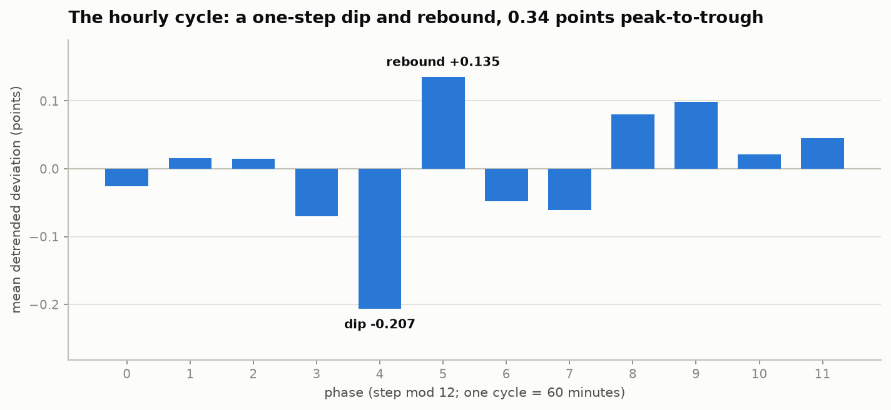
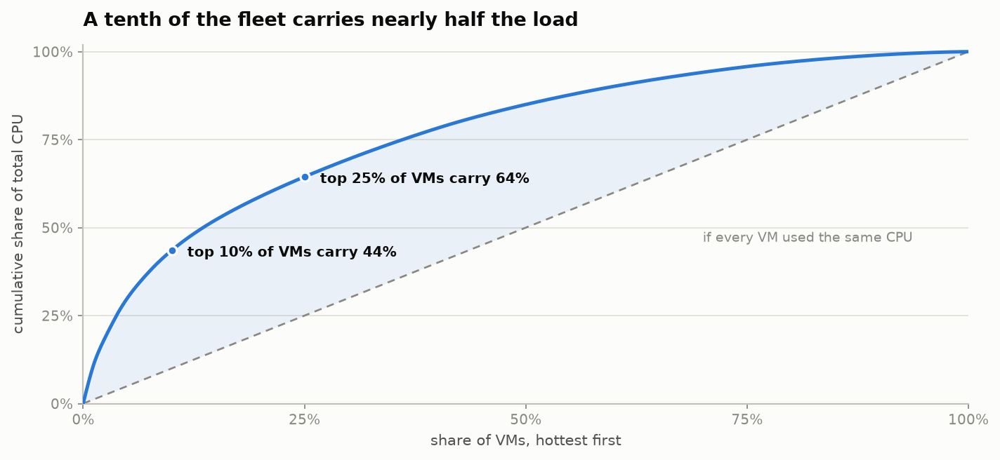
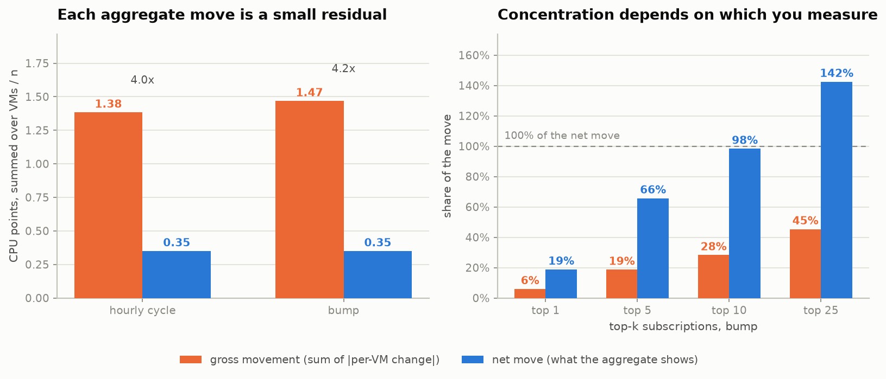

# Cloud Workload Forecasting — Final Report

**Dataset:** Azure Public Dataset V2, `data-v1` — 10,000 VMs × 134 five-minute
observations (11.08 h), 1,340,000 VM-level readings.
**Task:** forecast the final 24 timestamps (2 h) of `active_vm_count` and
`aggregate_cpu_utilization`.
**Protocol:** model, band and policy frozen and git-tagged
(`frozen-before-holdout`) before the holdout was scored; scored once.

Detail tables are in the [appendix](#appendix); supporting analysis is in
`reports/01`–`03` and [`DECISIONS.md`](../DECISIONS.md) (32 entries).

---

## 1. Executive summary

**How predictable is this workload?** Highly, but trivially, and only for about
40 minutes. Fleet utilisation sits at **9.41%** and never leaves a **0.80-point
band**. A genuine **60-minute cycle** worth 0.34 points peak-to-trough is the
one real structure: removing it halves step-to-step volatility (sd of
differences 0.158 → 0.082) and lifts lag-1 autocorrelation from 0.662 to
**0.879**. Beyond step 9 recent history predicted worse than the long-run mean
in validation — though the holdout contradicted that (§6).

**How accurately can near-term demand be forecast?** To about **0.12–0.16 CPU
points over two hours, 1.3–1.7% WAPE**. The best holdout model was
`last_cycle_mean` (MAE **0.1230**); the model I froze scored **0.1609**,
placing **fourth of five** and losing to three baselines — a failure I recorded
in writing before scoring (§7). `active_vm_count` is constant at 10,000 and
every model scores MAE 0.0: degenerate by curation, not a forecasting success.

**What should an infrastructure team do with it?** Little, at this utilisation.
A 9× under/over cost ratio justifies a band of **0.37 points (3.9% of the
mean)** — free, and about the size of the fleet's own hourly swing (0.34). The
forecast is not where risk lives: **2.2% of VMs run above 50% while the fleet
sits at 9.4%**, and the top 10% of VMs carry 43.5% of all CPU. Watch the hot
tail, subtract the hourly profile before alerting, and investigate
**core-weighted** utilisation, which was easier to forecast relative to its own
variability in validation (MAE/sd 0.891 vs 1.008) though never scored on the
holdout.

---

## 2. Data understanding and preprocessing

**The data is pristine — a finding, not a step to skip.** Across 1,340,000
rows: 0 nulls, 0 non-finite values, 0 duplicate `(vm_id, timestamp)` pairs, 0
values outside [0,100], `min ≤ avg ≤ max` everywhere, and a perfectly regular
grid. The missing-data requirement is answered by a **documented proof of
absence**.

The cleaning paths still exist and are tested, since a substituted dataset may
not be clean: duplicates collapse or average, an absent grid slot yields NA for
both targets, and a present timestamp with no usable reading yields count 0 and
a NaN mean — **zero and "no observation" stay distinct, and nothing is filled**.
One validity predicate serves both targets so they cannot diverge; out-of-range
values are kept and flagged, since dropping them would silently change the VM
count.

**`active_vm_count` is degenerate by curation** — constant at 10,000, derivable
from row counts alone. `DATA_CARD.md` states the rule: "Only VMs with complete
traces across the selected observation window were eligible." Zero churn is a
construction artefact; a real fleet needs arrivals and departures modelled
separately. **Lifetimes are censored at both ends and the sample is survivors
only**: creation is 0 for every VM, and 82.1% of deletions sit on the upstream
30-day trace boundary.


---

## 3. Workload analysis


Flat near 9.4 for ~50 steps, a bump to ~9.9 across steps 53–72, then a slide to
~9.15. Total range 0.80 points, sd 0.19.



**The hourly cycle is real and mechanically simple:** a one-step dip at phase 4
(−0.207) and rebound at phase 5 (+0.135), detected as period 12 only because
the differenced ACF clears the white-noise band at *both* lag 12 (+0.608) and
lag 24 (+0.576). Amplitude 0.342 points — **2.8× the mean step change**.
Removing it halves step-to-step sd (0.158 → 0.082), lifts lag-1 autocorrelation
to **0.879**, and eliminates all three harmonics (significant diff-ACF lags 17
→ 3). **The raw lag-1 figure understates how smooth this workload is** — a team
sizing alerts off raw volatility would set them ~2× too wide.



Demand is heavily right-skewed: median per-VM CPU 5.50% against a mean of
9.41%. **The top 10% of VMs carry 43.5% of all CPU; 2.2% average above 50%, and
5.8% below 1%.** Interactive VMs run hotter (11.51) than delay-insensitive
(8.26).

**Both aggregate moves are small residuals of much larger offsetting activity.**
The hourly jump nets +0.349 points on 1.383 of gross movement (**4.0×
cancellation**, 5,815 VMs up, 4,185 down); the bump nets +0.349 on 1.468 (4.2×).
Roughly half the fleet moves *against* the aggregate each time, so net-only
shares exceed 100% and overstate concentration 3–4× — appendix A.4 charts both
measures side by side. The two events have **different drivers** (per-VM
contributions correlate +0.056), and the bump is far more concentrated (top 10
subscriptions = 98.3% of net) than the cycle (38.3%).

**The detector I tested for catching the bump early was unusable**: recall 6/10
at best, precision under 4%, and 60–450 false-alarm episodes per hour across
2,324 subscriptions, 874 of them (38%) flagged before the event at the loosest
threshold. Hundreds of tenants ramp as hard as the real drivers without moving
the aggregate. That rules out this detector, not early detection in general
(appendix A.5).


---

## 4. Forecasting approach

Seasonality is **detected, never assumed**: the largest differenced-ACF peak is
accepted only if the ACF clears the white-noise band at both that lag and twice
it, per fold. Without a detected period every model degrades to a non-seasonal
analogue.

**Baselines:** persistence, last-cycle mean, seasonal-naive, training mean.
**Candidates:** an hourly phase profile combined with four level estimators
(last cycle, training mean, AR(1)-reverting toward the training mean, toward
the last 4P), plus damped Holt-Winters.

That candidate set follows directly from a validation result: `train_mean` beat
every recency-anchored baseline, so over 24 steps the **level** estimate
mattered more than the seasonal shape. The candidates therefore vary the level
estimator while holding the profile fixed.

**Selected: `profile_train_mean`** — hourly phase profile plus a
full-training-mean level. The AR(1) term was **dropped** despite a nominally
lower mean MAE: its fitted φ jumps from ~0.39 in the earliest folds to ~0.85 in
all later ones, coinciding exactly with the bump entering the training window,
and at φ≈0.85, φ²⁴ ≈ 0.0005 — fully decayed before the horizon ends. A
parameter set by one event, buying no measurable accuracy, was not worth the
failure mode.

---

## 5. Validation methodology

Expanding-window rolling origin inside the training window: fit on `[0, o)`,
forecast `[o, o+H)`. `min_train = max(2H, 4P+2) = 50`, origin step 3, **13
folds** at origins 50, 53, …, 86. The first origin is the shortest window on
which the detector can examine the 2P harmonic, so no fold silently runs
non-seasonal; step 3 spreads origins across phases of the cycle.

**Folds overlap, so every spread figure here is descriptive.** The paired
standard error in appendix A.2 is a *ranking heuristic* — a scale for "is this
gap bigger than the fold-to-fold wobble" — not a hypothesis test, since 13
folds sharing most of their history fail the independence one assumes.

**The selection rule was amended before freezing.** The pre-registered rule —
"within one fold-standard-deviation, the simpler model wins" — measures how
much fold *difficulty* varies, not how reliably one model beats another; that
band admitted five of nine candidates and would have selected `train_mean`. The
amended rule uses one standard error of the **paired** per-fold difference,
admitting exactly two models. Both rules and their outcomes are logged
(entry 19), so a reviewer can confirm the change did not depend on holdout
performance.

**The profile had to earn its place mechanistically, not on MAE**, the two
survivors differing by 0.0002. The tiebreak was a four-part falsifiable
prediction — `train_mean`'s bias is positive at the dip and negative at the
rebound, and the profile shrinks both — and all four held: +0.2182 and −0.1427,
reduced 82% and 69%, with `corr(profile effect, per-phase bias) = −0.966`
(entry 21).

**Leakage controls** are listed in the README, and tested rather than asserted:
corrupting every holdout reading leaves predictions **bit-identical**.


---

## 6. Results versus baseline


**Predictability horizon.** Persistence's skill against `train_mean` is
positive through step 8, first turns negative at **step 9**, and reaches −0.281
by step 24.

**The holdout contradicts this.** That ~40-minute horizon is a *validation*
result; on the holdout the recency-anchored models led on cumulative MAE at
every checkpoint out to step 24, so the predicted crossover never appeared. The
horizon is **regime-dependent, not a property of the workload**: it held while
the level oscillated and vanished once it trended.

Across the 13 training folds `profile_train_mean` scored MAE **0.1952** against
0.2267 for persistence (+13.9% skill) and 0.2615 for last-cycle mean; full
table in appendix A.1.


**On the holdout the ranking inverted.**

| model | MAE | bias | MASE | skill vs persistence |
|---|---:|---:|---:|---:|
| `last_cycle_mean` | **0.1230** | −0.053 | 1.016 | **+0.162** |
| `seasonal_naive` | 0.1400 | −0.053 | 1.156 | +0.046 |
| `persistence` | 0.1468 | −0.104 | 1.212 | 0.000 |
| **`profile_train_mean`** (selected) | 0.1609 | **+0.145** | 1.328 | **−0.096** |
| `train_mean` | 0.1746 | +0.145 | 1.442 | −0.189 |

The holdout mean is 9.2690 against a training mean of 9.4141 — the slide
continued — and the frozen model over-forecast at **20 of 24 steps**. The two
models that lost worst in validation placed first and second. The scoring
command re-derives the submission and checks it on five points (column order,
row count, holdout timestamps, and each target column matching the pipeline);
all passed.

---

## 7. Error and failure analysis

**This failure was predicted in writing before the gate.** `DECISIONS.md` entry
22, from the last four training folds:

| model | MAE last 4 folds | MAE first 9 | bias last 4 |
|---|---:|---:|---:|
| `profile_train_mean` | 0.1839 | 0.2002 | **+0.1839** |
| `persistence` | **0.1213** | 0.2736 | +0.0084 |

Bias equalling MAE means **no error changed sign**: every prediction was too
high during the slide. The entry stated that if the decline continued, the
selected model would over-forecast and persistence would score better.

**That was actionable from training data alone, and I chose not to act on it.**
No holdout knowledge was needed — a recency-weighted selection rule, or
selecting on the most recent folds only, would have preferred a recent-level
model from the training window by itself. I declined because it meant a
*second* post-hoc change to the selection rule, after the paired-standard-error
amendment, justified by four overlapping folds covering one episode; a recency
weight tuned on that evidence looked like fitting the rule to the tail of the
training window. **In hindsight the recency-weighted design was better**, and
the cost of that judgement is the 31% MAE gap in §6.

**What failed and what held.** The profile component held: the selected model
beat `train_mean` 0.1609 vs 0.1746 on the holdout, so the piece the mechanistic
gate tested did its job. The **level estimator** failed, assuming a reversion
the data never demonstrated. The root cause is sample size in *regimes*: the
window holds one bump and one decline, 13 folds re-use that single episode 13
times, and overlapping folds cannot manufacture a second regime. The same
weakness that justified dropping the AR(1) term also undermined the
mean-anchored level — applied consistently, and still wrong.

**The evaluation is thin where it matters most.** The training 90th percentile
is 9.6684 and the holdout maximum 9.6360, so **zero holdout points qualify as
peaks** and the required peak metric has no observations: the holdout is the
tail of a decline then a mild recovery (+0.017/step), with no high-load period
at all. Peak behaviour is known only from the training folds (77 peak points),
where every model that won on average under-forecast peaks — `profile_train_mean`
bias **−0.330**, `train_mean` **−0.342**, `last_cycle_mean` **−0.291**.
`profile_last_cycle` had the lowest peak MAE (0.280) and `persistence` the next
(0.283) but much the smallest bias (**−0.151**): a recency-anchored forecast
tracks a rising edge that a mean-anchored one cannot.


---

## 8. Capacity-planning recommendation

The band adds the q-quantile of the under-forecast distribution to the
forecast, per horizon bucket, widths constrained non-decreasing. The cost claim
is the **target breach rate** — 10%, i.e. running short costs 9× what idling
costs — and the nominal quantile is calibrated to deliver it rather than
assumed to: shipped q = 0.875, replayed breach 9.9% (appendix A.3).

**On the holdout: 0 breaches of 24, mean idle 0.5125 points.** Not a success —
the band held because the point forecast was biased high, so 0% says nothing
about quantile calibration. The informative number is cost: **0.51 points of
reserved headroom is about two-thirds of the series' entire 0.80-point training
range.**

**Policy.**

1. **Provision to the band, not the point forecast.** At ~9.4% utilisation
   0.37 points is free — but it is a *forecast-error* margin, about the size of
   the fleet's own hourly swing (0.34), not a capacity margin.
2. **Watch the hot tail, not the mean** — that is where capacity risk
   concentrates and the aggregate forecast cannot see it. Using the share of
   VMs above 50% as a trigger is a **proposal, not a validated rule**: I did
   not forecast it, backtest a threshold, or measure its false-alarm rate, and
   §3 shows a similar segment trigger failing badly.
3. **Treat the hourly rebound as scheduled, not stochastic**, subtracting the
   profile before alerting or thresholds end up ~2× too wide. Whether to lean
   on recent history past ~40 minutes is **regime-dependent** (§6) — the folds
   said no, the holdout said yes. A hedging method such as a damped local trend
   is the natural candidate, but it is **untested here**, and the one damped
   method I did validate (Holt-Winters with damped trend) ranked **last of
   nine** with the widest fold spread, so treat it as a hypothesis rather than
   a recommendation.
4. **Only if `vm_category` is available at forecast time and is not derived
   from the VM's own later behaviour** (limitation 4), delay-insensitive
   capacity (8.26) is a safer place to borrow headroom from than interactive
   (11.51). That provenance is unverified here — treat it as a hypothesis to
   check against the scheduler's own labels.
5. **Investigate core-weighted utilisation as the target**, since capacity is
   bought in cores and that series was easier to forecast relative to its own
   variability in validation (MAE/sd **0.891** vs 1.008). **Validation-only** —
   never scored on the holdout — so a lead, not a switch.
6. **Do not build the policy on the demand-ramp detector tested here** (§3).

**Under- vs over-provisioning** are two decisions, and the band addresses only
the first. *Fleet headroom*: at ~9.4% mean utilisation the asymmetry favours
over-provisioning, since 0.37 points is a fraction of a percent of capacity, so
a 9× ratio is cheap to honour — but that ratio is an assumption I chose, not
one estimated from data, and would need re-costing at 70% utilisation where
idle headroom stops being free. *Per-VM hot-tail risk* has a different unit of
harm: an SLA breach on one of the 2.2% of VMs above 50% is not averted by
fleet-level headroom, because the aggregate can be comfortable while a single
VM saturates. Nothing here forecasts or validates that risk.


---

## 9. Limitations and future work

1. **One 11-hour window, one bump, one decline** — the binding constraint; it
   caused the model loss and no fold engineering can fix it.
2. **No calendar structure.** 11.08 hours cannot show daily or weekly
   seasonality, and trace-relative timestamps make calendar features
   unconstructible.
3. **Survivorship and censoring.** Only complete traces were kept; creation is
   left-censored and 82% of deletions right-censored at the trace end.
4. **`vm_category` may itself be derived from lifetime behaviour.** If assigned
   from behaviour over the full 30-day trace, it encodes information from
   beyond the forecast origin, so it is **descriptive only, never a feature** —
   read the §3 segment findings as correlation, not as something a forecaster
   could condition on at run time.
5. **`active_vm_count` is uninformative**: constant by curation, so its perfect
   score measures nothing.
6. **The holdout contains no peak period**, leaving the required peak analysis
   unvalidated out-of-sample.
7. **Band calibration rests on overlapping folds.** Leave-one-fold-out removes
   a fold's own residuals but not shared history, so breach rates stay
   optimistic; per-bucket rates are uneven (~15% / 14% / 5%).
8. **Attribution is descriptive** — one episode cannot support a causal
   scheduling claim. **`">24"` cores mapped to 24**, a stated lower bound.

**Future work, in priority order.** (1) Re-run on a longer trace — the only fix
for limitations 1 and 2. (2) Try replacing the global-mean level with a **damped
local trend**, which hedges between reversion and continuation rather than
betting on one. This is **untested**: damped Holt-Winters ranked last of nine in
validation (MAE 0.2875, fold sd 0.241), so a damped *level* is a hypothesis
suggested by the failure, not a result. (3) Evaluate core-weighted utilisation
on held-out data. (4) Forecast the hot-tail share directly, since that is where
operational risk sits. (5) Segment-level forecasting for the top ~25
subscriptions — 62% of the *net* hourly cycle but only 38% of its gross
movement, and the gross figure bounds what a segment model could explain.
(6) Evaluate across several rolling holdout windows; one 24-step holdout with
no peak period cannot discriminate between models.

---

# Appendix

### A.1 Model comparison across 13 training folds

| model | MAE | fold sd | RMSE | bias | WAPE | MASE | skill vs persistence |
|---|---:|---:|---:|---:|---:|---:|---:|
| `profile_ar1_train_mean` | 0.1949 | 0.054 | 0.2162 | +0.032 | 2.06% | 1.57 | +14.0% |
| **`profile_train_mean`** | 0.1952 | 0.052 | 0.2182 | +0.012 | 2.06% | 1.57 | +13.9% |
| `train_mean` | 0.2045 | 0.054 | 0.2340 | +0.010 | 2.16% | 1.64 | +9.8% |
| `profile_ar1_recent_mean` | 0.2118 | 0.050 | 0.2327 | +0.051 | 2.24% | 1.70 | +6.6% |
| `persistence` | 0.2267 | 0.103 | 0.2621 | +0.079 | 2.39% | 1.82 | 0.0% |
| `profile_last_cycle` | 0.2553 | 0.098 | 0.2780 | +0.114 | 2.70% | 2.05 | −12.6% |
| `last_cycle_mean` | 0.2615 | 0.096 | 0.2905 | +0.114 | 2.77% | 2.10 | −15.3% |
| `seasonal_naive` | 0.2758 | 0.093 | 0.3109 | +0.114 | 2.92% | 2.21 | −21.7% |
| `holt_winters` | 0.2875 | **0.241** | 0.3226 | +0.195 | 3.02% | 2.30 | −26.8% |

Holt-Winters is best at h ≤ 5 (skill +0.711 at step 1) but has one fold at MAE
0.9715.

Peak performance on the same folds (77 peak points, peak = actual ≥ that fold's
training 90th percentile):

| model | peak MAE | peak bias |
|---|---:|---:|
| `profile_last_cycle` | 0.2803 | −0.280 |
| `persistence` | 0.2827 | **−0.151** |
| `last_cycle_mean` | 0.2908 | −0.291 |
| `seasonal_naive` | 0.3225 | −0.297 |
| `profile_train_mean` | 0.3297 | −0.330 |
| `train_mean` | 0.3419 | −0.342 |

### A.2 Paired per-fold differences against the leader

| model | mean diff | se | mean/se | folds worse |
|---|---:|---:|---:|---:|
| `profile_train_mean` | +0.0002 | 0.0071 | **0.03** | 7/13 |
| `train_mean` | +0.0096 | 0.0075 | 1.27 | 9/13 |
| `profile_ar1_recent_mean` | +0.0169 | 0.0049 | **3.46** | 9/13 |
| `persistence` | +0.0318 | 0.0260 | 1.22 | 7/13 |
| `seasonal_naive` | +0.0809 | 0.0277 | 2.92 | 10/13 |
| `holt_winters` | +0.0926 | 0.0654 | 1.42 | 7/13 |

### A.3 Capacity policy, replayed leave-one-fold-out

**The shipped policy.** Target breach rate **10%**, encoding a **9× under/over
cost ratio**. The nominal quantile is calibrated to deliver that target, not
assumed to: it comes out at **q = 0.875**, replaying to a **9.9%** breach rate.
Nominal q is a calibration knob here and carries no cost interpretation of its
own — reading 0.875 as "7×" would misstate the policy.

Nominal-q sweep (all with the monotone width constraint applied):

| nominal q | mean increment | replayed breach | mean idle |
|---:|---:|---:|---:|
| 0.80 | 0.323 | 15.4% | 0.348 |
| **0.875** (shipped) | **0.369** | **9.9%** | 0.389 |
| 0.90 | 0.410 | 7.4% | 0.427 |
| 0.95 | 0.463 | 3.2% | 0.477 |

Two increment figures appear in this report and they are different quantities:

| bucket | shipped band (pooled over all 13 folds) | mean of the 13 held-out bands | replayed breach |
|---|---:|---:|---:|
| 1–6 | 0.364 | 0.367 | 15.4% |
| 7–12 | 0.368 | 0.371 | 14.1% |
| 13–24 | 0.368 | 0.371 | 5.1% |

The first column is the band actually shipped, built once from every training
fold; the second is the average width across the 13 leave-one-fold-out replays
used to estimate what it costs. One quantile plus a monotone constraint cannot
equalise the three buckets' breach rates.

### A.4 Net versus gross attribution



| event | net | gross | cancellation | VMs up / down |
|---|---:|---:|---:|---:|
| hourly dip→rebound | +0.349 | 1.383 | 4.0× | 5,815 / 4,185 |
| bump (steps 53–72) | +0.349 | 1.468 | 4.2× | 4,727 / 5,273 |

| top-10 subscriptions | share of net | share of gross |
|---|---:|---:|
| hourly cycle | 38.3% | **18.1%** |
| bump | 98.3% | **28.3%** |


### A.5 Prospective detector

| threshold | recall | precision | median lead | false alarms/hour |
|---:|---:|---:|---:|---:|
| +2 | 6/10 | 0.69% | 210 min | 453 |
| +5 | 6/10 | 1.79% | 198 min | 152 |
| +10 | 5/10 | 3.36% | 190 min | 60 |

### A.6 Core-weighted versus unweighted target (validation only)

The core-weighted series was **never scored on the holdout**, so this is a
validation-window comparison. The two series also have different scales and
variances, which makes raw MAE a poor comparator — **MAE/sd is the figure to
read**; the raw MAE row is shown only to make that scaling explicit.

| | core-weighted | unweighted |
|---|---:|---:|
| mean / sd | 9.3131 / 0.1770 | 9.4141 / 0.1936 |
| correlation with unweighted | 0.9027 | 1.0 |
| profile amplitude | 0.4067 | 0.3416 |
| **MAE / series sd** | **0.891** | **1.008** |
| (raw MAE, not comparable across scales) | 0.1578 | 0.1952 |

### A.7 Reproducing this report

```bash
python -m pytest -q
python -m cwfc.predict --data challenge_data --output predictions.csv
python -m cwfc.score_holdout --data challenge_data --predictions predictions.csv
python analysis/01_data_and_workload.py
python analysis/02_cycle_attribution.py
python analysis/03_validation_and_policy.py
python analysis/figures.py
```
