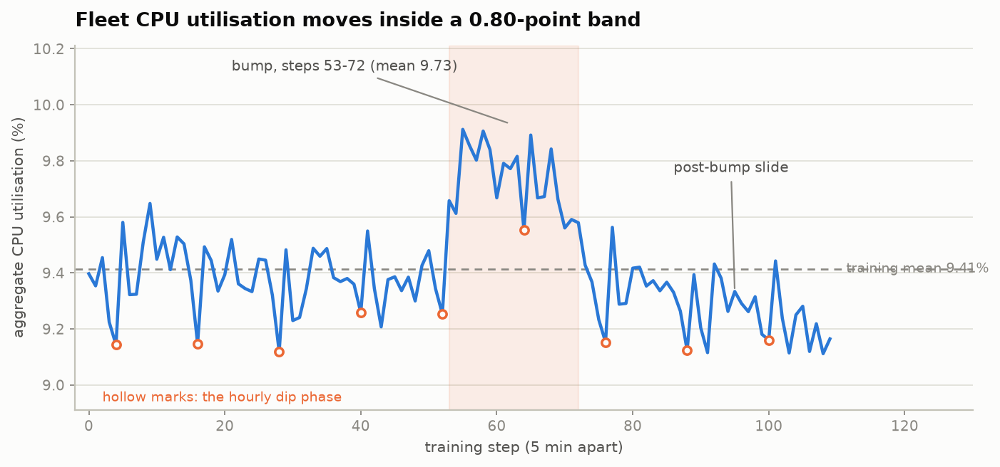
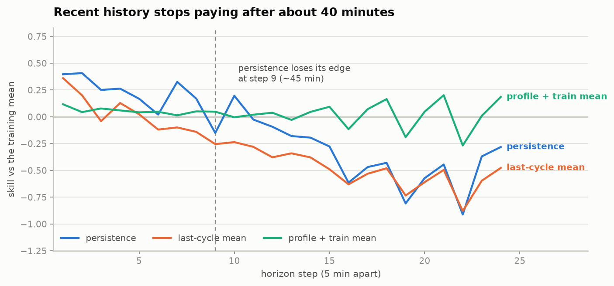
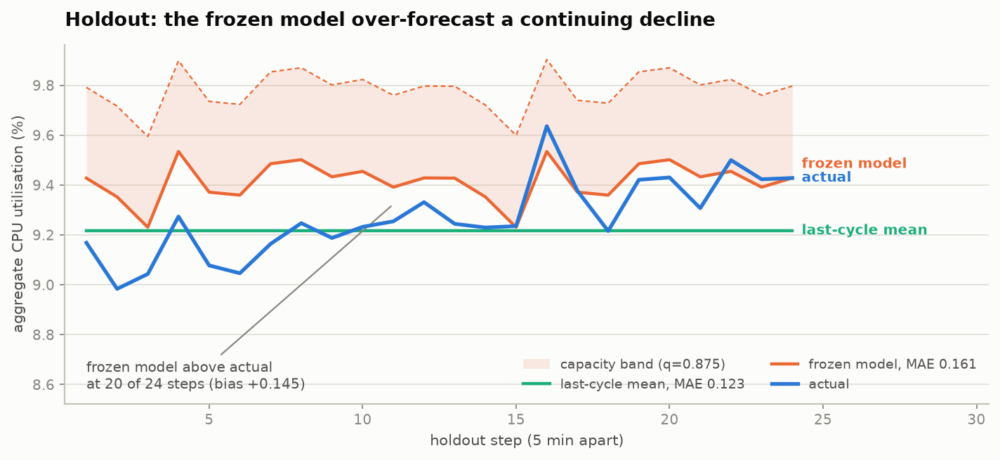

# Cloud Workload Forecasting — Final Report

**Dataset:** Azure Public Dataset V2, `data-v1` — 10,000 VMs × 134 five-minute
observations (11.08 h), 1,340,000 VM-level readings.
**Task:** forecast the final 24 timestamps (2 h) of `active_vm_count` and
`aggregate_cpu_utilization`.
**Protocol:** model, band and policy frozen and git-tagged
(`frozen-before-holdout`) before the holdout was scored; scored once.

Detail tables are in the [appendix](#appendix); supporting analysis is in
`reports/01`–`03` and [`DECISIONS.md`](../DECISIONS.md) (31 entries).

---

## 1. Executive summary

**How predictable is this workload?** Highly, but trivially so, and only for
about 40 minutes. Fleet utilisation sits at **9.41%** and never leaves a
**0.80-point band**. There is a genuine **60-minute cycle** worth 0.34 points
peak-to-trough, and removing it halves step-to-step volatility (sd of
differences 0.158 → 0.082) while lifting lag-1 autocorrelation from 0.662 to
**0.879**. Beyond **step 9 (~40 minutes)** recent history predicts worse than
the long-run mean.

**How accurately can near-term demand be forecast?** To about **0.12–0.16 CPU
points over two hours — 1.3–1.7% WAPE**. The best holdout model was
`last_cycle_mean` (MAE **0.1230**); our frozen model scored **0.1609**, placing
**fourth of five** and losing to three baselines. `active_vm_count` is constant
at 10,000 and every model scores MAE 0.0 — it is degenerate by curation, not a
forecasting success.

**What should an infrastructure team do with it?** Little, at this utilisation.
A 9× under/over cost ratio justifies a band of **0.37 points (3.9% of the
mean)**, which is operationally free but smaller than the fleet's own hourly
swing. The forecast is not where risk lives: **2.2% of VMs run above 50% while
the fleet sits at 9.4%**, and the top 10% of VMs carry 43.5% of all CPU.
Monitor the hot tail, subtract the hourly profile before alerting, and forecast
**core-weighted** utilisation instead (MAE 0.158 vs 0.195 with the same model).

The most useful result is the negative one: the model lost **in the way we said
it would**, and that failure localises precisely what 11 hours of data cannot
teach.

---

## 2. Data understanding and preprocessing

**The data is pristine — a finding, not a step to skip.** Across 1,340,000
rows: 0 nulls, 0 non-finite values, 0 duplicate `(vm_id, timestamp)` pairs, 0
values outside [0,100], and `min ≤ avg ≤ max` everywhere. The grid is perfectly
regular: 134 timestamps, every consecutive difference exactly 300 s, and
`span/step + 1 = 134` exactly. The missing-data requirement is therefore
answered by a **documented proof of absence**.

The cleaning paths still exist and are tested, because a substituted dataset
may not be clean: identical duplicates collapse, conflicting duplicates
average, an absent grid slot yields NA for both targets, and a timestamp
present with no usable reading yields count 0 and a NaN mean. **Zero and "no
observation" are kept distinct, and nothing is ever filled.**

One validity predicate — `avg_cpu` non-null and finite — serves both targets,
so "VM is active at *t*" and "VM contributes to the mean at *t*" cannot
diverge. Out-of-range values are **kept and flagged**, not dropped: an
implausible reading is still real data, and excluding it would silently change
the VM count.

**`active_vm_count` is degenerate by curation.** It is constant at 10,000,
derivable from row counts alone (1,340,000 = 10,000 × 134 with zero
duplicates). The release kept only VMs with complete traces, so zero churn is
an artefact of dataset construction. A real fleet has arrivals and departures
needing separate treatment.

**Lifetimes are censored at both ends.** `timestamp_vm_created` is 0 for every
VM (left-censored). 8,213 of 10,000 deletions (82.1%) sit on one timestamp —
2,591,400 s, the upstream 30-day trace boundary — i.e. right-censored. **The
sample is survivors only.**

---

## 3. Workload analysis



The series is flat near 9.4 for ~50 steps, bumps to ~9.9 across steps 53–72,
then slides to ~9.15. Total range 0.80 points, sd 0.19.


**The hourly cycle is real and mechanically simple:** a one-step dip at phase 4
(−0.207) and rebound at phase 5 (+0.135), detected as period 12 only because
the differenced ACF clears the white-noise band at *both* lag 12 (+0.608) and
lag 24 (+0.576). Amplitude 0.342 points — **2.8× the mean step change**.

Removing it is the most informative transformation in the analysis: step-to-step
sd falls 0.158 → 0.082, lag-1 autocorrelation rises 0.662 → **0.879**, and all
three seasonal harmonics vanish (significant diff-ACF lags 17 → 3). **The raw
lag-1 figure understates how smooth this workload is** — a team sizing alert
thresholds off raw volatility would set them roughly twice too wide.


Demand is heavily right-skewed: median per-VM CPU 5.50% against a mean of
9.41%. **The top 10% of VMs carry 43.5% of all CPU; 2.2% average above 50%,
and 5.8% below 1%.** Interactive VMs run hotter (11.51) than delay-insensitive
(8.26).

**Both aggregate moves are small residuals of much larger offsetting activity.**
The hourly jump nets +0.349 points on 1.383 of gross movement (**4.0×
cancellation**, 5,815 VMs up and 4,185 down); the bump nets +0.349 on 1.468
(4.2×, 4,727 up, 5,273 down). Roughly half the fleet moves *against* the
aggregate in each event. Net-only shares exceed 100% and overstate
concentration 3–4×, so net and gross are reported together throughout
(appendix A.4).

The two events have **different drivers** — per-VM contributions correlate
+0.056. The bump is far more concentrated (top 10 subscriptions = 98.3% of the
net move, lifts 23–37×) than the cycle (38.3%).

**The bump could not have been caught prospectively.** A causal detector —
flagging subscriptions by trailing 12-step growth using only data up to each
step — achieves 0.7–3.4% precision against the top-10-driver label, with
60–450 false-alarm episodes per hour across 2,324 subscriptions. At the loosest
threshold 874 subscriptions (38%) are flagged before the event. Hundreds of
tenants ramp as hard as the real drivers without moving the aggregate.

---

## 4. Forecasting approach

Seasonality is **detected, never assumed**: the largest differenced-ACF peak is
accepted only if the ACF clears the white-noise band at both that lag and twice
it, per fold. Without a detected period every model degrades to a non-seasonal
analogue.

**Baselines:** persistence, last-cycle mean, seasonal-naive, training mean.
**Candidates:** an hourly phase profile combined with four level estimators
(last cycle, training mean, AR(1)-reverting toward the training mean, toward
the last 4P), plus damped Holt-Winters.

That candidate set follows directly from a validation result: `train_mean` beat
every recency-anchored baseline, so over 24 steps the **level** estimate
mattered more than the seasonal shape. The candidates therefore vary the level
estimator while holding the profile fixed.

**Selected: `profile_train_mean`** — hourly phase profile plus a
full-training-mean level. The AR(1) term was **dropped** despite a nominally
lower mean MAE: its fitted φ jumps from ~0.39 in the earliest folds to ~0.85 in
all later ones, coinciding exactly with the bump entering the training window,
and at φ≈0.85, φ²⁴ ≈ 0.0005 — fully decayed before the horizon ends. A
parameter set by one event, buying no measurable accuracy, was not worth the
failure mode.

---

## 5. Validation methodology

Expanding-window rolling origin inside the training window: fit on `[0, o)`,
forecast `[o, o+H)`. `min_train = max(2H, 4P+2) = 50`, origin step 3, **13
folds** at origins 50, 53, …, 86 (the last exactly `N−H`). The first origin is
the shortest window on which the detector can examine the 2P harmonic, so every
fold answers the seasonality question for the same reason rather than one fold
silently running non-seasonal. Step 3 spreads origins across phases of the
cycle. **Folds overlap, so spread is an indicator only and no significance test
is used anywhere.**

**The selection rule was amended before freezing.** The pre-registered rule —
"within one fold-standard-deviation, the simpler model wins" — failed on
contact with the data: that band is built from the winner's MAE spread *across
folds*, which measures how much fold difficulty varies, not how reliably one
model beats another. With overlapping folds it spanned 0.1949–0.2489 and
admitted five of nine candidates, down to `persistence`; applied literally it
selects `train_mean`. The amended rule uses one standard error of the **paired**
per-fold difference, narrowing the band from 0.0539 to 0.0071 and admitting
exactly two models. Both rules and their outcomes are recorded, so a reviewer
can confirm the change did not depend on holdout performance.

**The profile had to earn its place mechanistically, not on MAE.** The two
surviving models differed by 0.0002 MAE (0.03 paired se) — unseparable by
accuracy. The tiebreak was a falsifiable prediction: `train_mean` should show
positive bias at the dip phase and negative bias at the rebound, and the
profile should remove it. All four checks passed (+0.2182 and −0.1427, reduced
by 82% and 69%), with `corr(profile effect, per-phase bias) = −0.966`.

**Leakage controls.** Split index derived from sorted timestamps (`110` appears
nowhere); period, profile, MASE scale, peak threshold and band quantiles all
fitted per fold on that fold's training slice; metadata lifetime statistics
descriptive only; `predict` and `score_holdout` separate entry points; model
and band frozen in `src/cwfc/frozen.py` and tagged before scoring. Verified by
test: corrupting every holdout reading with 999 / −1 / 0 / NaN leaves
predictions **bit-identical** (max abs diff 0.00e+00).

---

## 6. Results versus baseline



**Predictability horizon.** Persistence's skill against `train_mean` runs
+0.397, +0.408, +0.251, +0.263, +0.169, +0.021, +0.326, +0.170 over steps 1–8,
first turns negative at **step 9**, and reaches −0.281 by step 24. The crossing
is noisy at this sample size, so ~40 minutes is approximate, not a threshold.

Across the 13 training folds, `profile_train_mean` scored MAE **0.1952** versus
0.2267 for persistence (**+13.9% skill**) and 0.2615 for last-cycle mean. Full
table in appendix A.1.



**On the holdout the ranking inverted.**

| model | MAE | bias | MASE | skill vs persistence |
|---|---:|---:|---:|---:|
| `last_cycle_mean` | **0.1230** | −0.053 | 1.016 | **+0.162** |
| `seasonal_naive` | 0.1400 | −0.053 | 1.156 | +0.046 |
| `persistence` | 0.1468 | −0.104 | 1.212 | 0.000 |
| **`profile_train_mean`** (selected) | 0.1609 | **+0.145** | 1.328 | **−0.096** |
| `train_mean` | 0.1746 | +0.145 | 1.442 | −0.189 |

The holdout mean is 9.2690 against a training mean of 9.4141 — the slide
continued — and the frozen model over-forecast at **20 of 24 steps**. The two
models that lost worst in validation placed first and second. Submission
integrity passed all five checks.

---

## 7. Error and failure analysis

**This failure was predicted in writing before the gate.** `DECISIONS.md` entry
22, from the last four training folds:

| model | MAE last 4 folds | MAE first 9 | bias last 4 |
|---|---:|---:|---:|
| `profile_train_mean` | 0.1839 | 0.2002 | **+0.1839** |
| `persistence` | **0.1213** | 0.2736 | +0.0084 |

Bias equalling MAE means **no error changed sign** — every prediction was too
high during the post-bump slide. The entry stated that if the decline
continued, the selected model would over-forecast and persistence would score
better. Acting on that would have required knowing where the holdout sits in
the series, which is precisely the leakage the protocol forbids.

**Separating what failed from what held:**

- **The profile component held.** The selected model beat `train_mean` 0.1609
  vs 0.1746 (+0.079 skill) on the holdout — the part the mechanistic gate
  tested did its job.
- **The level estimator failed.** Anchoring on the full training mean assumed a
  reversion the data never demonstrated.
- **The root cause is sample size in *regimes*, not in observations.** The
  window contains one bump and one decline. Thirteen folds re-use that single
  episode thirteen times; overlapping folds cannot manufacture a second regime.
  The same single-episode weakness that justified dropping the AR(1) term also
  undermined the mean-anchored level — the inference was applied consistently
  and was still wrong.

**The evaluation itself is thin where it matters most.** The training 90th
percentile is 9.6684 and the holdout maximum is 9.6360, so **zero holdout
points qualify as peaks** and the required peak metric has no observations. The
holdout is the tail of a decline followed by a mild recovery (+0.017/step) — it
contains no high-load period at all. Peak behaviour is therefore known only
from training folds, where every model that won on average under-forecast peaks
(bias −0.31 to −0.34) and persistence was best on peaks (MAE 0.1989).

---

## 8. Capacity-planning recommendation

The band's upper bound is the forecast plus the q-quantile of the
under-forecast distribution, per horizon bucket, with widths constrained
**non-decreasing**. The cost claim lives in the **target breach rate** — 10%,
i.e. running short costs 9× what idling costs — and the nominal quantile is
*calibrated* to deliver it, because a band built at nominal 0.90 breached 12.5%
out of fold. Shipped: nominal q = 0.875, increments 0.364 / 0.368 / 0.368,
replayed breach 9.9% (appendix A.3).

**On the holdout: 0 breaches of 24, mean idle 0.5125 points.** This is *not* a
success — the band held because the point forecast was biased high, so 0% says
nothing about quantile calibration. The informative number is cost: **0.51
points of reserved headroom exceeds the series' entire 0.80-point training
range.**

**Policy.**

1. **Provision to the band, not the point forecast**, for two-hour planning. At
   ~9.4% utilisation a 0.37-point margin is free — but it is a *forecast-error*
   margin, smaller than the fleet's own hourly swing, not a capacity margin.
2. **Monitor the hot tail, not the mean.** Track the share of VMs above 50% as
   the peak-risk trigger; the aggregate forecast cannot see it.
3. **Treat the hourly rebound as scheduled, not stochastic.** Subtract the
   profile before alerting, or thresholds will be ~2× too wide. Use recent
   history only inside the ~40-minute horizon; past that, plan to the level.
4. **Borrow headroom from delay-insensitive capacity** (8.26 mean) before
   interactive (11.51) when tight.
5. **Forecast core-weighted utilisation.** Capacity is bought in cores, and
   that target is both more predictable and more cyclical: same model, MAE
   0.1578 vs 0.1952, MAE/sd 0.891 vs 1.008, profile amplitude +19%.
6. **Do not build the policy on early detection of demand ramps** (§3).

**Under- vs over-provisioning.** At this utilisation the asymmetry strongly
favours over-provisioning: idle headroom costs a fraction of a percent of fleet
capacity, while running short on the hot tail risks SLA breaches on the 2% of
VMs that matter. That is why a 9× ratio is defensible here — and why the same
policy would need re-costing on a fleet running at 70%.

---

## 9. Limitations and future work

1. **One 11-hour window, one bump, one decline.** The binding constraint; it
   caused the model loss and no fold engineering can fix it.
2. **No calendar structure.** 11.08 hours cannot show daily or weekly
   seasonality, the dominant cycles in real cloud demand. Timestamps are
   trace-relative, so calendar features are not even constructible.
3. **Survivorship and censoring.** Only complete traces were kept; creation is
   left-censored and 82% of deletions right-censored at the trace end.
4. **`vm_category` may itself be derived from lifetime behaviour.** The
   upstream dataset documents it as a workload category, but if it was assigned
   from observed VM behaviour over the full 30-day trace, it encodes
   information from beyond the forecast origin. It is therefore used for
   **descriptive segmentation only and never as a feature**; the segment
   findings in §3 should be read as "these labels correlate with this
   behaviour", not as something a forecaster could condition on at run time.
5. **`active_vm_count` is uninformative** — constant by curation, so its
   perfect score measures nothing.
6. **The holdout contains no peak period**, so the required peak analysis is
   unvalidated out-of-sample.
7. **Band calibration rests on overlapping folds.** Leave-one-fold-out removes
   a fold's own residuals but not shared history, so breach rates stay
   optimistic and carry no confidence interval; per-bucket rates are uneven
   (~15% / 14% / 5%).
8. **Attribution is descriptive** — one episode cannot support a causal
   scheduling claim. **`">24"` cores mapped to 24**, a stated lower bound.

**Future work, in priority order.** (1) Re-run on a longer trace — the only fix
for limitations 1 and 2. (2) Replace the global-mean level with a **damped
local trend**, which hedges between reversion and continuation instead of
betting on one; this is the direct remedy for the observed failure. (3) Adopt
core-weighted utilisation as the primary target. (4) Forecast the hot-tail
share directly, since that is where operational risk sits. (5) Segment-level
forecasting for the ~25 subscriptions driving 62% of the net hourly cycle.
(6) Evaluate across several rolling holdout windows — a single 24-step holdout
with no peak period cannot discriminate between models.

---

# Appendix

### A.1 Model comparison across 13 training folds

| model | MAE | fold sd | RMSE | bias | WAPE | MASE | skill vs persistence |
|---|---:|---:|---:|---:|---:|---:|---:|
| `profile_ar1_train_mean` | 0.1949 | 0.054 | 0.2162 | +0.032 | 2.06% | 1.57 | +14.0% |
| **`profile_train_mean`** | 0.1952 | 0.052 | 0.2182 | +0.012 | 2.06% | 1.57 | +13.9% |
| `train_mean` | 0.2045 | 0.054 | 0.2340 | +0.010 | 2.16% | 1.64 | +9.8% |
| `profile_ar1_recent_mean` | 0.2118 | 0.050 | 0.2327 | +0.051 | 2.24% | 1.70 | +6.6% |
| `persistence` | 0.2267 | 0.103 | 0.2621 | +0.079 | 2.39% | 1.82 | 0.0% |
| `profile_last_cycle` | 0.2553 | 0.098 | 0.2780 | +0.114 | 2.70% | 2.05 | −12.6% |
| `last_cycle_mean` | 0.2615 | 0.096 | 0.2905 | +0.114 | 2.77% | 2.10 | −15.3% |
| `seasonal_naive` | 0.2758 | 0.093 | 0.3109 | +0.114 | 2.92% | 2.21 | −21.7% |
| `holt_winters` | 0.2875 | **0.241** | 0.3226 | +0.195 | 3.02% | 2.30 | −26.8% |

Holt-Winters is best at h ≤ 5 (skill +0.711 at step 1) but has one fold at MAE
0.9715.

### A.2 Paired per-fold differences against the leader

| model | mean diff | se | mean/se | folds worse |
|---|---:|---:|---:|---:|
| `profile_train_mean` | +0.0002 | 0.0071 | **0.03** | 7/13 |
| `train_mean` | +0.0096 | 0.0075 | 1.27 | 9/13 |
| `profile_ar1_recent_mean` | +0.0169 | 0.0049 | **3.46** | 9/13 |
| `persistence` | +0.0318 | 0.0260 | 1.22 | 7/13 |
| `seasonal_naive` | +0.0809 | 0.0277 | 2.92 | 10/13 |
| `holt_winters` | +0.0926 | 0.0654 | 1.42 | 7/13 |

### A.3 Capacity policy, replayed leave-one-fold-out

| q | cost ratio | mean increment | replayed breach | mean idle |
|---:|---:|---:|---:|---:|
| 0.80 | 4× | 0.323 | 15.4% | 0.348 |
| **0.875** (shipped) | — | **0.369** | **9.9%** | 0.389 |
| 0.90 | 9× | 0.410 | 7.4% | 0.427 |
| 0.95 | 19× | 0.463 | 3.2% | 0.477 |

Per bucket at the shipped q: 1–6 → increment 0.367, breach 15.4%; 7–12 → 0.371,
14.1%; 13–24 → 0.371, 5.1%. One quantile plus a monotone constraint cannot
equalise three buckets.

### A.4 Net versus gross attribution

| event | net | gross | cancellation | VMs up / down |
|---|---:|---:|---:|---:|
| hourly dip→rebound | +0.349 | 1.383 | 4.0× | 5,815 / 4,185 |
| bump (steps 53–72) | +0.349 | 1.468 | 4.2× | 4,727 / 5,273 |

| top-10 subscriptions | share of net | share of gross |
|---|---:|---:|
| hourly cycle | 38.3% | **18.1%** |
| bump | 98.3% | **28.3%** |

### A.5 Prospective detector

| threshold | recall | precision | median lead | false alarms/hour |
|---:|---:|---:|---:|---:|
| +2 | 6/10 | 0.69% | 210 min | 453 |
| +5 | 6/10 | 1.79% | 198 min | 152 |
| +10 | 5/10 | 3.36% | 190 min | 60 |

### A.6 Core-weighted versus unweighted target

| | core-weighted | unweighted |
|---|---:|---:|
| mean / sd | 9.3131 / 0.1770 | 9.4141 / 0.1936 |
| correlation with unweighted | 0.9027 | 1.0 |
| profile amplitude | **0.4067** | 0.3416 |
| frozen-model MAE | **0.1578** | 0.1952 |
| MAE / series sd | **0.891** | 1.008 |

### A.7 Reproducing this report

```bash
python -m pytest -q
python -m cwfc.predict --data challenge_data --output predictions.csv
python -m cwfc.score_holdout --data challenge_data --predictions predictions.csv
python analysis/01_data_and_workload.py
python analysis/02_cycle_attribution.py
python analysis/03_validation_and_policy.py
python analysis/figures.py
```
